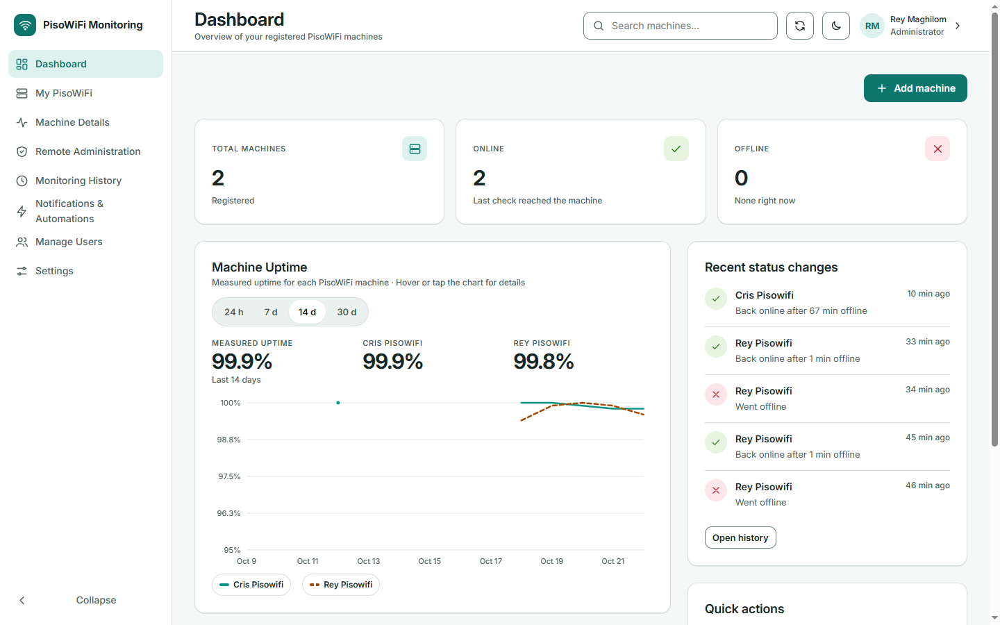
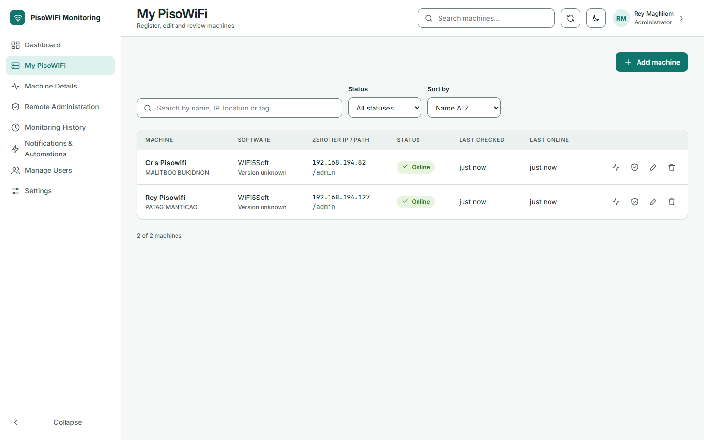
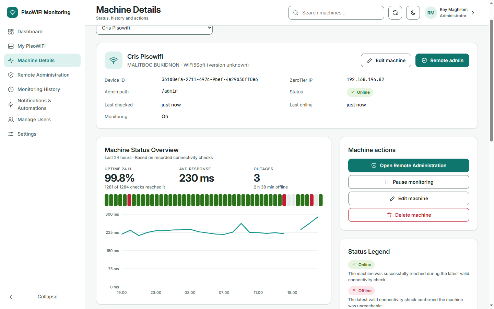
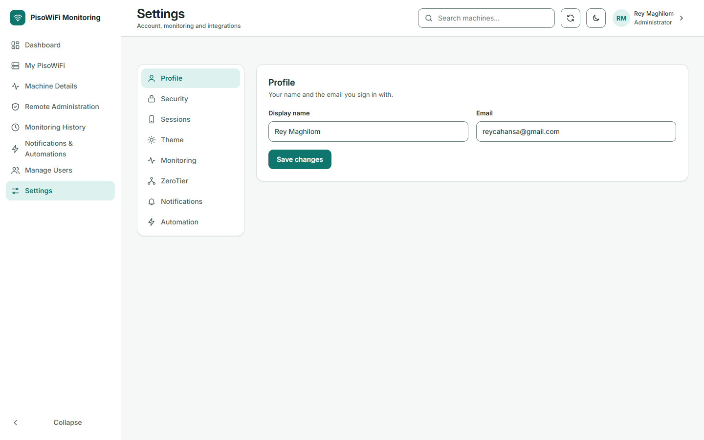

# PisoWiFi Monitoring System

## Overview

A personal full-stack web application I developed for my **PisoWiFi business** to monitor and remotely manage my WiFi5Soft machines.

The system allows me to check whether my machines are **Online (Reachable)** or **Offline (Unreachable)** and remotely access their administration dashboards to view sales, CPU usage, and other machine information.

## Key Features

- **Connectivity Monitoring** – Scheduled machine status checks and monitoring history.
- **Remote Administration** – Access WiFi5Soft admin dashboards through ZeroTier.
- **Automated Alerts** – n8n automation for Gmail outage and recovery notifications.
- **Cloud Hosting** – Hosted using Google Cloud Compute Engine (Ubuntu VPS).
- **User Management** – Secure authentication and role-based access.

## Screenshots

| Login Page | Dashboard |
|---|---|
|  |  |

| My PisoWiFi | Machine Details |
|---|---|
|  |  |

| Add PisoWiFi Machine | Remote Administration |
|---|---|
|  |  |

| Remote Admin Access | Settings |
|---|---|
|  |  |

## Tech Stack

| Category | Technologies |
|---|---|
| Frontend | Next.js, React, TypeScript, Tailwind CSS |
| Backend | Node.js, Fastify |
| Database | PostgreSQL, Supabase, Drizzle ORM |
| Automation | n8n, Gmail |
| Cloud & Networking | Google Cloud Compute Engine, ZeroTier |
| Testing | Vitest, Playwright |

## Project Purpose

Built to simplify the daily monitoring and remote administration of my PisoWiFi business without needing to visit each machine's physical location.

*Note: Sales, CPU usage, and other machine statistics are viewed through the existing WiFi5Soft admin dashboard, not collected directly by this application.*
